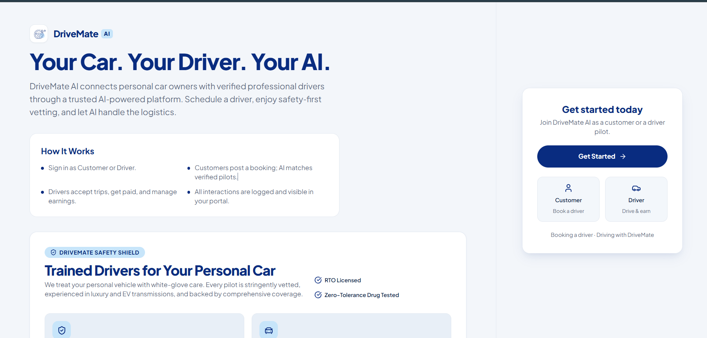
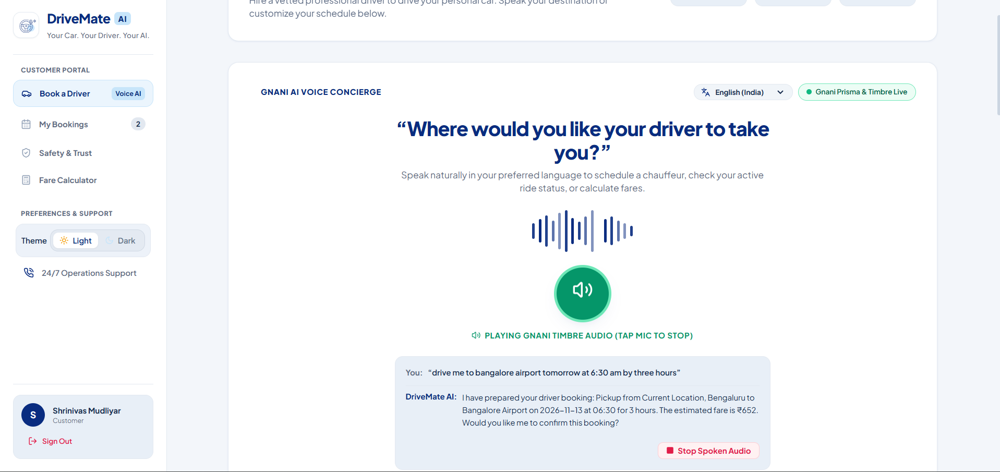
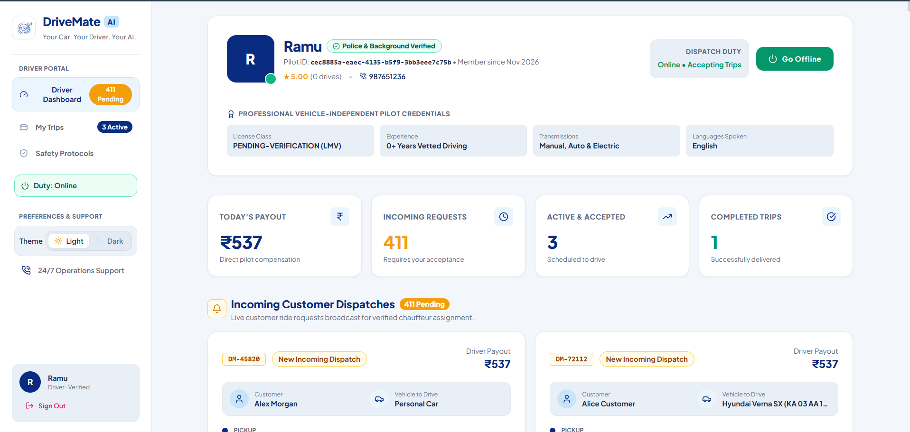
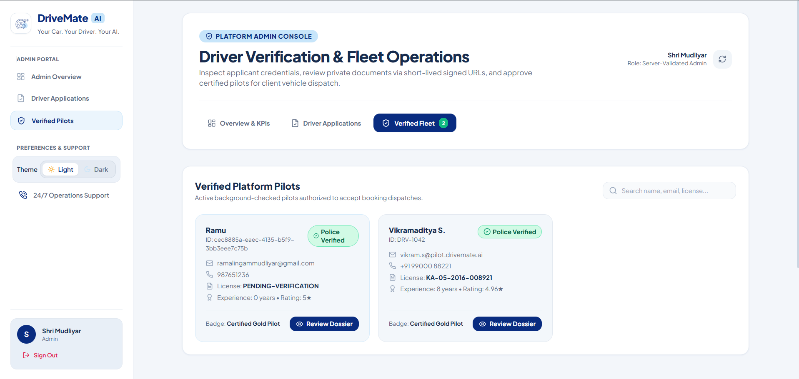
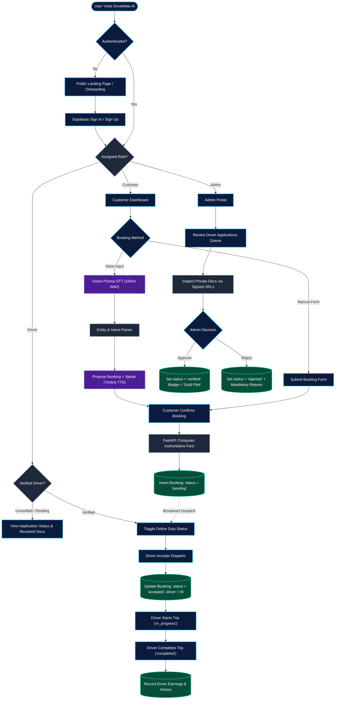
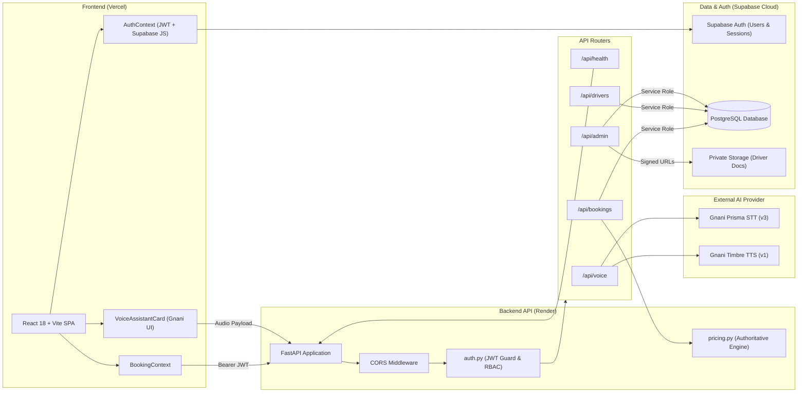

# DriveMate AI

<div align="center">


### **Your Car. Your Driver. Your AI.**

*On-demand, background-verified professional chauffeur dispatch platform powered by Gnani AI Voice Concierge, FastAPI, React, and Supabase.*

[](https://drive-mate-ai-black.vercel.app)
[](https://drivemate-ai.onrender.com/api/health)
[](https://drivemate-ai.onrender.com/docs)
[](backend/tests)
[](LICENSE)

[**Explore Live Web App**](https://drive-mate-ai-black.vercel.app) • [**Backend Health Check**](https://drivemate-ai.onrender.com/api/health) • [**Interactive API Docs**](https://drivemate-ai.onrender.com/docs) • [**GitHub Repository**](https://github.com/shrimudliyar/DriveMate-AI)

</div>

---

## Table of Contents

- [1. Application Overview](#1-application-overview)
- [2. The Real-World Problem](#2-the-real-world-problem)
- [3. Application Preview](#3-application-preview)
  - [Home Page](#home-page)
  - [Customer Dashboard](#customer-dashboard)
  - [Driver Dashboard](#driver-dashboard)
  - [Admin Portal](#admin-portal)
- [4. Key Features](#4-key-features)
  - [Customer Portal & Voice Concierge](#customer-portal--voice-concierge)
  - [Driver Portal & Trip Management](#driver-portal--trip-management)
  - [Admin Portal & Verification System](#admin-portal--verification-system)
  - [Security & Role-Based Access Control](#security--role-based-access-control)
- [5. How DriveMate AI Works](#5-how-drivemate-ai-works)
- [6. Technology Stack](#6-technology-stack)
- [7. System Architecture](#7-system-architecture)
- [8. Project Directory Structure](#8-project-directory-structure)
- [9. Installation & Local Setup](#9-installation--local-setup)
- [10. Authentication & User Roles](#10-authentication--user-roles)
- [11. Live Production Deployment](#11-live-production-deployment)
- [12. Future Enhancements](#12-future-enhancements)
- [13. Contributing](#13-contributing)
- [14. License & Author](#14-license--author)

---

## 1. Application Overview

**DriveMate AI** is a production-ready, full-stack chauffeur dispatch platform built for personal car owners. Rather than hailing a taxi or ride-share vehicle, DriveMate AI allows car owners to hire background-verified, professional drivers ("pilots") to drive the customer's own vehicle.

The platform bridges human chauffeurs and vehicle owners through a multimodal AI experience:
- **Spoken Voice Concierge:** Powered by **Gnani AI** (Prisma Speech-to-Text and Timbre Text-to-Speech), customers can book a driver by simply speaking their destination, required duration, and pickup time.
- **Dedicated Portals for Every Stakeholder:** Distinct role-based workspaces for **Customers**, **Drivers**, and **Administrators**, each tailored to specific operational workflows.
- **Fair & Authoritative Pricing:** Server-side fare and driver payout calculations with transparent hourly rates, vehicle tiers, night surge, duration discounts, and insurance protection.
- **Zero-Trust Administrative Vetting:** Every driver applicant undergoes strict administrative review, document verification, and police background clearance before being permitted to accept dispatches.

---

## 2. The Real-World Problem

In major metropolitan hubs like Bengaluru, traffic congestion, long commutes, and parking scarcity create severe daily stress for vehicle owners:

| Challenge | Traditional Ride-Hailing | The DriveMate AI Solution |
|---|---|---|
| **Vehicle Utilization** | Personal cars sit idle in parking garages while owners pay surge cab fares. | Your personal car is driven by a professional pilot while you work or rest in comfort. |
| **Driver Trust & Safety** | Informal driver hiring relies on unverified references with zero accountability. | 100% background-checked drivers with police clearance and an admin audit trail. |
| **Booking Friction** | Complicated multi-step mobile apps with rigid point-to-point drop-offs. | Speak naturally to the AI Voice Concierge to book multi-hour or outstation chauffeurs. |
| **Driver Economics** | Aggregators take high commissions; drivers struggle with auto loans and fuel costs. | Drivers earn transparent hourly payouts without vehicle maintenance or fuel liabilities. |

---

## 3. Application Preview

### Home Page
*The landing gateway of DriveMate AI showcasing the design system, value proposition, two-step authentication entrance, safety protocols, and quick role orientation.*

<div align="center">
  
</div>

> **Highlights:**
> - Responsive dual-panel design with quick access to Customer and Driver onboarding.
> - Transparent breakdown of platform safety protocols (background vetting, ₹10 lakh vehicle insurance guarantee, and SOS support).
> - One-click access to dynamic pricing overview and chauffeur hiring options.

---

### Customer Dashboard
*The central customer hub featuring the Gnani AI Voice Concierge with live audio waveform visualization, manual driver booking engine, ride status tracking, and trip history.*

<div align="center">
  
</div>

> **Highlights:**
> - **Gnani AI Voice Concierge:** Speak in English (`en-IN`), Hindi (`hi-IN`), or Kannada (`kn-IN`) with real-time audio waveform animations.
> - **Voice-to-Booking Entity Parser:** Automatically extracts pickup location, destination, booking date, time, and duration from natural speech.
> - **Personal Vehicle Selection:** Choose between Standard, Premium/SUV, and Outstation tiers with instant authoritative fare computation.
> - **Ride Lifecycle Tracking:** Real-time visual progress monitoring from *Pending Dispatch* to *Accepted*, *In-Progress*, and *Completed*.

---

### Driver Dashboard
*The verified chauffeur workspace featuring online/offline duty toggle, real-time incoming dispatches, one-click acceptance, and a dedicated My Trips section.*

<div align="center">
  
</div>

> **Highlights:**
> - **Duty Status Switcher:** Verified drivers toggle online/offline availability with server-enforced validation.
> - **Incoming Dispatches:** Live incoming ride requests showing customer route, vehicle tier, pickup time, and guaranteed pilot payout.
> - **Atomic Trip Acceptance:** Concurrency-safe assignment engine preventing double-booking across pilots.
> - **My Trips Workspace:** Dedicated sidebar navigation for viewing assigned drives, initiating trips, and tracking completed rides without scrolling through incoming dispatches.

---

### Admin Portal
*The operational control center for system administrators to monitor platform health, review driver applications, inspect private credentials, and manage fleet approvals.*

<div align="center">
  
</div>

> **Highlights:**
> - **System KPI Overview:** Real-time counters for pending applications, verified pilots, rejected submissions, total fleet size, and active trips.
> - **Driver Application Verification:** Search and filter applicants by verification status, name, email, or commercial license number.
> - **Private Document Inspection:** Authorized signed URLs allow admins to securely view driver licenses, ID proofs, and police clearance records without exposing public storage buckets.
> - **Audit-Logged Decision Engine:** Approve drivers to issue *Certified Gold Pilot* credentials or reject with mandatory explanatory feedback.

---

## 4. Key Features

### Customer Portal & Voice Concierge
- **Multimodal Booking:** Book a driver either via conversational voice audio or structured manual forms.
- **Gnani AI Integration:**
  - **Prisma STT:** Cloud-based speech-to-text with bounded 15-second timeouts, automatic retries, and clean error sanitization.
  - **Timbre TTS:** High-fidelity spoken audio feedback using the Indian English `Nalini` voice model.
  - **Natural Entity Extraction:** Extracts destination, pickup, duration, and schedules from spoken queries.
- **Server-Authoritative Pricing:**
  - Base hourly rates: Standard (₹179/hr), Premium/SUV (₹229/hr), Outstation (₹259/hr).
  - Duration discounts: 8% off for 6+ hours, 12% off for 8+ hours (full-day).
  - Night allowance: ₹150 surcharge automatically applied between 22:00 and 06:00.
  - Inclusive vehicle and occupant insurance safety fee (₹39) and platform charge (₹49).
- **Self-Service Trip Cancellation:** Customers can safely cancel pending or unstarted bookings with instant database updates.

### Driver Portal & Trip Management
- **Role Verification Guard:** Drivers must possess verified credentials (`Police & Background Verified`) before the server allows them to toggle online duty or accept dispatches.
- **Real-Time Incoming Dispatches:** View customer pickup, destination, duration, vehicle model, and calculated pilot earnings.
- **Independent "My Trips" Workspace:** Directly manage active assignments, start drives, and complete trips from a dedicated tab.
- **Performance Metrics:** View personal statistics including completed drives, acceptance rates, and total pilot payout earnings.
- **Document Re-Submission:** Rejected applicants can update their license or background documents to request re-evaluation.

### Admin Portal & Verification System
- **Executive KPI Dashboard:** Real-time counters tracking pending verifications, verified pilots, total fleet, active rides, and total bookings.
- **Driver Verification Review:** Complete view of applicant profiles, contact information, driving experience, and document links.
- **Secure Document Previews:** Generates short-lived Supabase Storage signed URLs to inspect private credentials.
- **Strict Approval/Rejection Workflow:** Approving elevates a driver to *Certified Gold Pilot*; rejecting enforces a mandatory reason recorded in the database.

### Security & Role-Based Access Control
- **Zero-Trust Token Verification:** Dual-layer JWT verification strategy:
  1. Cryptographic local decode using `SUPABASE_JWT_SECRET` (HS256).
  2. Fallback to Supabase Auth API (`auth.get_user`) for token validation.
- **Privilege Escalation Protection:** Admin privileges are enforced strictly through trusted Supabase `app_metadata` (service-role managed only). Client-editable `user_metadata` cannot elevate user roles.
- **Database-Level Isolation:** Customers only access their own bookings; drivers only access pending dispatches and trips assigned to them.
- **Production Guardrails:** Demo authentication tokens are strictly forbidden and blocked in production environments.

---

## 5. How DriveMate AI Works

The following flowchart illustrates the complete user lifecycle from authentication to trip completion:



---

## 6. Technology Stack

### Frontend
-  **React 18** — Component-driven declarative UI.
-  **Vite** — Next-generation frontend tooling and rapid HMR.
-  **Tailwind CSS** — Custom utility-first design system with full dark/light mode.
-  **Lucide React** — Modern, consistent icon library.
- **Context API** — Global state management for authentication, bookings, and theme preferences.

### Backend
-  **FastAPI** — High-performance asynchronous Python REST API framework.
-  **Python 3.12** — Modern type-hinted runtime.
-  **Uvicorn** — Lightning-fast ASGI web server implementation.
-  **Pydantic v2** — Strict data validation and schema serialization.
-  **HTTPX** — Async HTTP client for external AI service communication.
-  **PyJWT** — Cryptographic JSON Web Token signature verification.

### Database, Storage & Authentication
-  **Supabase Auth** — Secure user authentication with session persistence and automatic token refresh.
-  **PostgreSQL** — Relational schema storing customer profiles, driver credentials, and booking state.
- **Supabase Storage** — Secure storage bucket for driver documents with short-lived signed URLs.

### Voice AI & Audio Processing
- **Gnani AI Prisma STT** (`https://api.vachana.ai/stt/v3`) — Speech-to-text processing Indian English dialects.
- **Gnani AI Timbre TTS** (`https://api.vachana.ai/api/v1/tts/inference`) — Text-to-speech synthesis with the `Nalini` voice model.
- **FFmpeg Integration** — Server-side conversion of browser MediaRecorder audio (WebM/Opus) into 16kHz mono 16-bit PCM WAV.

### Cloud Deployment & DevOps
-  **Vercel** — Automated frontend CI/CD deployment with SPA route rewriting.
-  **Render** — Managed containerized backend web service with continuous deployment.
-  **Pytest** — Comprehensive unit and integration test suite (89 tests).

---

## 7. System Architecture



---

## 8. Project Directory Structure

```text
DriveMate-AI/
├── .env.example                     # Template for frontend environment variables
├── index.html                       # HTML entry point with metadata & branding
├── package.json                     # Frontend dependencies & npm build scripts
├── postcss.config.js                # PostCSS plugins configuration
├── tailwind.config.js               # DriveMate AI custom theme & color palettes
├── vercel.json                      # Vercel deployment configuration & SPA rewrites
├── vite.config.js                   # Vite configuration with /api backend proxy
│
├── screenshots/                     # Verified application preview screenshots
│   ├── home-page.png                # Public landing page screenshot
│   ├── customer-dashboard.png       # Customer booking & voice concierge screenshot
│   ├── driver-dashboard.png         # Driver portal & incoming dispatches screenshot
│   └── admin-dashboard.png          # Admin KPI & application review screenshot
│
├── public/                          # Static assets served directly
│   ├── favicon.svg                  # Application SVG icon
│   └── images/                      # High-resolution logos & branding assets
│
├── src/                             # React frontend source code
│   ├── main.jsx                     # React DOM entry point
│   ├── App.jsx                      # Main app shell & role navigation switcher
│   ├── index.css                    # Tailwind directives & design system utilities
│   ├── api/
│   │   ├── client.js                # Centralized REST client with token injection
│   │   └── supabase.js              # Supabase JS client initialization
│   ├── context/
│   │   ├── AuthContext.jsx          # Supabase auth state, user profile, role logic
│   │   ├── BookingContext.jsx       # Real-time bookings state & dispatch actions
│   │   └── ThemeContext.jsx         # Dark / Light theme toggle & persistence
│   ├── components/
│   │   ├── admin/                   # Admin Portal views, KPI stats & review modal
│   │   ├── auth/                    # AuthModal, GetStartedModal, ResetPasswordModal
│   │   ├── booking/                 # BookingForm, FareEstimator, StatusScreen
│   │   ├── common/                  # ErrorBoundary, BrandLogo, RoleSwitcher, Badge
│   │   ├── driver/                  # DriverPortal, DriverTripsWorkspace, ProfileCard
│   │   ├── layout/                  # Navbar, Sidebar, Footer components
│   │   ├── pages/                   # PublicHome unauthenticated landing page
│   │   ├── safety/                  # SafetySection & vetting standards display
│   │   ├── trips/                   # BookingsList, BookingCard components
│   │   └── voice/                   # VoiceAssistantCard, AudioWaveform visualizer
│   └── utils/
│       └── pricing.js               # Client-side pricing display helpers
│
└── backend/                         # FastAPI Python backend
    ├── requirements.txt             # Python backend dependencies
    ├── render.yaml                  # Render cloud hosting blueprint specification
    ├── schema_v4.sql                # Production PostgreSQL schema migration script
    ├── .env.example                 # Backend environment variable template
    │
    ├── app/                         # Backend application package
    │   ├── __init__.py
    │   ├── main.py                  # FastAPI app creation, CORS, startup hooks
    │   ├── config.py                # Environment settings & configuration loading
    │   ├── database.py              # Supabase PostgreSQL client & data access layer
    │   ├── auth.py                  # JWT validation & role-based route dependencies
    │   ├── models.py                # Pydantic request/response schemas
    │   ├── pricing.py               # Authoritative server-side pricing algorithm
    │   └── routes/                  # Modular API route controllers
    │       ├── admin.py             # Administrative KPI & driver review endpoints
    │       ├── bookings.py          # Booking CRUD & atomic lifecycle mutations
    │       ├── drivers.py           # Driver profiles, metrics, & duty status
    │       ├── health.py            # Service health & Supabase connectivity check
    │       └── voice.py             # Gnani AI STT & TTS integration with retry logic
    │
    ├── scripts/                     # Operational utility scripts
    │   ├── provision_admin.py       # Safe admin provisioning tool via Supabase API
    │   └── setup_demo_accounts.py   # Seed script for initial development records
    │
    └── tests/                       # Pytest test suite (89 tests)
        ├── test_admin.py            # Admin authorization & review workflow tests
        ├── test_api.py              # Booking lifecycle & pricing API tests
        ├── test_auth.py             # Security, JWT decode, & RBAC guard tests
        ├── test_direct.py           # Direct database & business logic tests
        ├── test_live_dispatch.py    # Concurrency & driver assignment tests
        └── test_voice.py            # Gnani STT/TTS resilience & 504 handling tests
```

---

## 9. Installation & Local Setup

### Prerequisites
- **Node.js:** v18.0.0 or higher
- **Python:** v3.11 or v3.12
- **Git:** Version control
- **FFmpeg:** Optional but recommended (for converting browser WebM audio to 16kHz PCM WAV)

---

### Step 1: Clone the Repository
```bash
git clone https://github.com/shrimudliyar/DriveMate-AI.git
cd DriveMate-AI
```

---

### Step 2: Configure Environment Variables

#### Frontend Environment:
Create a `.env` file in the root directory:
```bash
cp .env.example .env
```
Populate `.env` with your Supabase credentials:
```env
VITE_SUPABASE_URL=https://your-project-id.supabase.co
VITE_SUPABASE_ANON_KEY=your-supabase-anon-key-here
VITE_API_URL=/api
```

#### Backend Environment:
Create a `.env` file inside the `backend/` directory:
```bash
cp backend/.env.example backend/.env
```
Populate `backend/.env` with your backend secrets:
```env
SUPABASE_URL=https://your-project-id.supabase.co
SUPABASE_SERVICE_ROLE_KEY=your-supabase-service-role-secret-key-here
SUPABASE_ANON_KEY=your-supabase-anon-key-here
SUPABASE_JWT_SECRET=your-supabase-jwt-secret-here

HOST=127.0.0.1
PORT=8000
ENVIRONMENT=development
ENABLE_DEMO_AUTH=true

CORS_ORIGINS=http://localhost:5173,http://127.0.0.1:5173
CORS_ORIGIN_REGEX=^https:\/\/.*\.vercel\.app$

GNANI_API_KEY=your-gnani-api-key-here
GNANI_BASE_URL=https://api.vachana.ai
GNANI_STT_MODEL=gnani-prisma-v2.5
GNANI_TTS_MODEL=timbre-v2.5
GNANI_TTS_VOICE=Nalini
GNANI_LANGUAGE_CODE=en-IN
```

> [!IMPORTANT]
> Never commit actual `.env` files to Git. Keep `SUPABASE_SERVICE_ROLE_KEY` and `GNANI_API_KEY` strictly on the backend.

---

### Step 3: Install Backend Dependencies & Start Server
```bash
cd backend
python -m venv venv

# On Windows:
venv\Scripts\activate

# On macOS/Linux:
source venv/bin/activate

pip install -r requirements.txt
uvicorn app.main:app --host 127.0.0.1 --port 8000 --reload
```
The backend API will be available at:
- **API Root:** `http://127.0.0.1:8000`
- **Swagger Documentation:** `http://127.0.0.1:8000/docs`
- **Health Check:** `http://127.0.0.1:8000/health`

---

### Step 4: Install Frontend Dependencies & Start App
In a separate terminal window from the root directory:
```bash
npm install
npm run dev
```
The application will launch at:
- **Local Web App:** `http://localhost:5173`

---

### Step 5: Run the Test Suite
Ensure all 89 backend tests pass:
```bash
cd backend
venv\Scripts\pytest.exe tests -v
```

---

## 10. Authentication & User Roles

DriveMate AI implements a zero-trust, role-based access control (RBAC) architecture separating users into three distinct roles:

```text
┌────────────────────────────────────────────────────────────────────────┐
│                        SUPABASE AUTHENTICATION                         │
└───────────────────────────────────┬────────────────────────────────────┘
                                    │
                  Bearer JWT Token (Verified by FastAPI)
                                    │
        ┌───────────────────────────┼───────────────────────────┐
        ▼                           ▼                           ▼
  [ CUSTOMER ]                 [ DRIVER ]                  [ ADMIN ]
  • Role: 'customer'           • Role: 'driver'            • app_metadata.role == 'admin'
  • Book personal driver       • Verification Gatekeeper   • Inspect KPI counters
  • Use Voice Concierge        • Online/Offline Duty       • Review driver documents
  • Track ride status          • Accept incoming rides     • Approve / Reject pilots
  • Cancel pending rides       • Manage My Trips           • System audit trail
```

### 1. Customer Role
- **Privileges:** Create ride requests, use the Gnani AI Voice Concierge, track active ride statuses, and cancel pending or accepted bookings.
- **Data Scope:** Scoped strictly to bookings matching the customer's own authenticated `customer_id`.

### 2. Driver Role
- **Verification Gatekeeper:** A registered driver account starts in the `pending_verification` state. The backend **strictly rejects** unverified drivers from toggling online duty status or receiving dispatches until an administrator approves their credentials.
- **Privileges (Once Verified):** Receive live incoming ride dispatches, accept rides atomically, execute the trip lifecycle (`accepted` → `in_progress` → `completed`), and review earnings in the My Trips workspace.

### 3. Administrator Role
- **Privilege Protection:** Administrator authorization is verified strictly via trusted Supabase `app_metadata` (`app_metadata.role == 'admin'`). Client-editable `user_metadata` claims are explicitly disregarded, completely preventing privilege escalation attacks.
- **Privileges:** Inspect fleet overview KPIs, review applicant credentials, generate authorized signed URLs for private driver documents, approve applications to issue *Certified Gold Pilot* badges, or reject applications with mandatory audit feedback.

---

## 11. Live Production Deployment

DriveMate AI is fully deployed across production cloud infrastructure:

| Component | Platform | Production URL | Status |
|---|---|---|---|
| **Frontend Web App** | Vercel | [drive-mate-ai-black.vercel.app](https://drive-mate-ai-black.vercel.app) |  |
| **Backend REST API** | Render | [drivemate-ai.onrender.com](https://drivemate-ai.onrender.com) |  |
| **Backend Health Check** | Render | [drivemate-ai.onrender.com/api/health](https://drivemate-ai.onrender.com/api/health) |  |
| **Interactive API Docs** | Render | [drivemate-ai.onrender.com/docs](https://drivemate-ai.onrender.com/docs) |  |

---

## 12. Future Enhancements

The following roadmap items represent planned future capabilities:

- [ ] **Live GPS Turn-by-Turn Telemetry:** Mapbox or Google Maps integration for live visual tracking of the driver en route to the pickup point.
- [ ] **Native Mobile Driver Application:** React Native / Flutter mobile app for drivers with push notification alerts for incoming ride broadcasts.
- [ ] **Chauffeur Subscription Plans:** Recurring monthly chauffeur passes for corporate commuters requiring daily office commute drivers.
- [ ] **Multi-Language Voice Expansion:** Full regional dialect support for Kannada and Hindi speech input across all booking dialogues.
- [ ] **Automated Payment Gateway:** Integration with Razorpay / Stripe for automated pilot payouts and in-app customer billing.

---

## 13. Contributing

Contributions are welcome! Please follow these steps:

1. **Fork the Repository:** Create your own branch (`git checkout -b feature/AmazingFeature`).
2. **Commit Your Changes:** Keep commits modular and descriptive (`git commit -m 'feat: add live route mapping'`).
3. **Run the Test Suite:** Ensure all 89 backend tests pass (`pytest backend/tests`).
4. **Verify Frontend Build:** Confirm the production build succeeds without warnings (`npm run build`).
5. **Push to Your Fork:** (`git push origin feature/AmazingFeature`).
6. **Open a Pull Request:** Submit a PR to `main` with a clear explanation of changes.

---

## 14. License & Author

### License
This project is open-source and licensed under the **[MIT License](LICENSE)**.

### Author
**Shrinivas Mudliyar**
- GitHub: [@shrimudliyar](https://github.com/shrimudliyar)
- Repository: [DriveMate-AI](https://github.com/shrimudliyar/DriveMate-AI)

---

<div align="center">

**DriveMate AI** — *Your Car. Your Driver. Your AI.*

Made with dedication for safe, seamless, and intelligent personal mobility.

</div>
